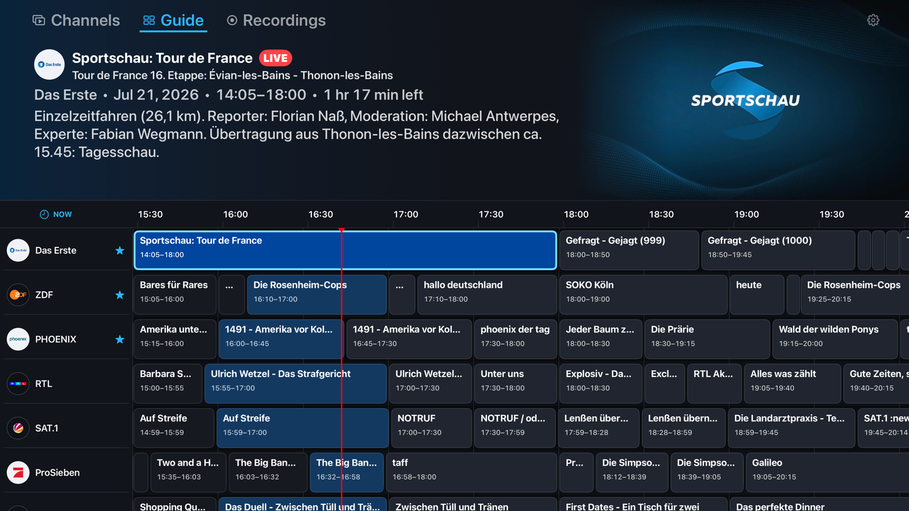

# TV Player for Apple Platforms

TV Player is a native TVheadend client for Apple TV, iPhone, iPad, and Mac.
Browse the programme guide, watch and pause live television, schedule
recordings, and manage your library from an interface designed for each Apple
platform.



## What TV Player offers

### Live TV and programme guide

- A timeline guide with channel logos, programme artwork, descriptions, and a
  clear live-time indicator
- Favourite channels pinned above the normal TVheadend channel order
- Immediate playback from Channels or Guide, without an extra details step
- Programme details with **Watch Live**, **Record Once**, and **Record All**
- Recording status shown directly in the guide
- Fast guide restoration while fresh data is loaded in the background

### Playback and time-shift

- Live pause, resume, backward and forward seeking, and return to live when
  TVheadend time-shift is available
- A programme-aware playback timeline showing the current position and
  available time-shift window
- Audio and subtitle selection, stream-profile selection, and synchronization
  controls
- Technical playback information for diagnosing stream or connection issues
- Continued live playback without pause and seeking when native time-shift is
  unavailable

Time-shift storage and retention follow the TVheadend server configuration;
TV Player does not maintain a separate buffer on the device.

### Recordings

- Views for recordings in progress, upcoming, completed, and failed
- Record All rules for recurring programmes
- Actions to cancel scheduled recordings, stop active recordings, delete
  completed recordings, and remove recording rules
- Playback of completed and still-growing recordings
- Separate **Watch from Start** and **Watch Live** choices for an active
  recording

### Made for Apple devices

- Remote-first focus navigation and a ten-foot interface on Apple TV
- Compact touch layouts on iPhone
- Sidebar, pointer, and regular-width layouts on iPad
- Native windows, menus, full-screen playback, and keyboard transport controls
  on Mac
- Passwords stored in the platform Keychain

### Simple server setup

TV Player can be configured manually in Settings or discover a server published
over Bonjour/mDNS. An optional [Discovery container](Discovery/README.md) can
advertise a complete TVheadend configuration and provide a richer guide with
historical programmes and native event metadata.

Discovery broadcasts configuration on the local network. Use it only on a
trusted LAN and give its TVheadend account the minimum permissions it needs.

## Requirements

- A reachable TVheadend server
- A TVheadend account with Web Interface and streaming access
- **Basic recorder** permission to view and schedule recordings
- **View All** and **Failed View** for the corresponding recording lists
- **Manage All** when managing recordings created by other users
- TVheadend time-shift and HTSP access for live pause and seeking

TV Player uses the account's default DVR profile, including padding, priority,
retention, duplicate handling, and recording format.

## Getting started

Open Settings and provide the server URL, username, password, stream profile,
and HTSP port. The usual TVheadend ports are `9981` for HTTP and `9982` for
HTSP. Optional guide-cache and XMLTV URLs can also be supplied.

Settings shows connection and time-shift status so configuration problems are
visible before playback starts.

## License

TV Player's own source code is available under the [MIT License](LICENSE).
VLCKit, libVLC, and other bundled dependencies retain their respective
licenses; see [Third-party notices](THIRD_PARTY_NOTICES.md).

## Development

Development requires Xcode with the iOS, macOS, and tvOS 26 SDKs and
[XcodeGen](https://github.com/yonaskolb/XcodeGen). Install VLCKit and generate
the project with:

```sh
bash Scripts/install-vlckit.sh
xcodegen generate
```

Build all application targets with:

```sh
bash Scripts/build-all.sh
```

`TVApp.xcodeproj` is generated from `project.yml` and is intentionally not
tracked. The application bundle identifier is `de.beutner.TVPlayer`.

### Apple TV Simulator

The simulator helper prompts for the password without writing it to disk:

```sh
bash Scripts/run-simulator.sh http://tvheadend.local:9981 username
```

An optional simulator UDID can be supplied as the third argument.

### Server probe

To verify server information, profiles, channels, and guide access independently
of the app, run:

```sh
bash Scripts/probe-tvheadend.sh http://tvheadend.local:9981 username
```
